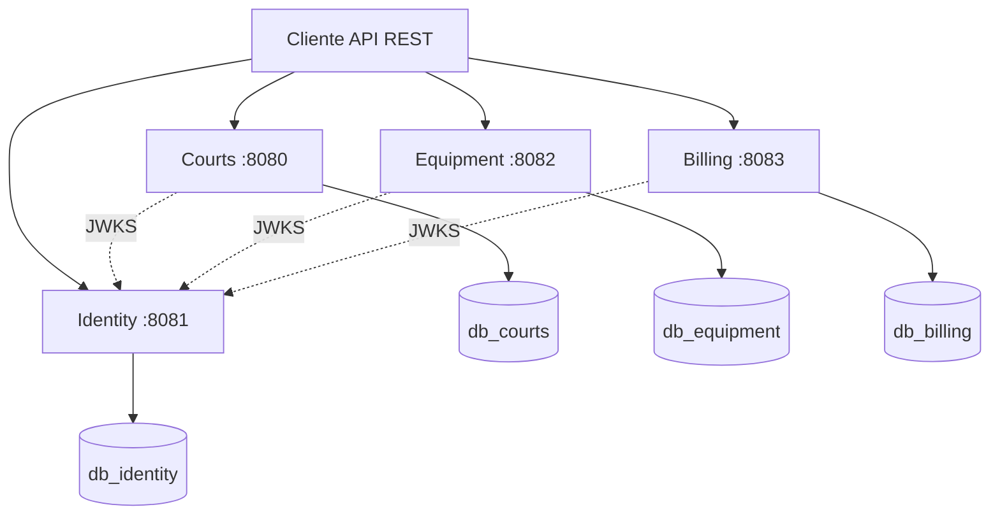

<div align="center">

# ⚽ A R E N A C O R E

### GolFlow · Sports Facility Management System

**Reserva · Administra · Conecta**


[Proyecto](#proyecto) · [Documentación](#documentacion) · [Arquitectura](#arquitectura) · [Seguridad](#seguridad) · [Instalación](#instalacion) · [Equipo](#equipo)

</div>

---

<a id="proyecto"></a>
## 🏟️ Sobre el proyecto

ArenaCore (GolFlow) es un backend de gestión de canchas sintéticas y complejos deportivos basado en cuatro microservicios. Centraliza usuarios, sedes, disponibilidad, reservas, préstamos de implementos, liquidaciones y pagos.

### Problemática

La gestión manual de horarios, inventario y cobros puede generar reservas duplicadas, inconsistencias de stock y dificultades para rastrear las operaciones.

### Objetivo

Facilitar la administración de complejos deportivos mediante servicios independientes, persistencia aislada y operaciones consistentes y trazables.

### Alcance funcional

| Dominio | Funcionalidades |
| --- | --- |
| Identidad | Usuarios, roles RBAC, auditoría y autenticación JWT |
| Canchas | Sedes, fútbol 5/7/8/11, disponibilidad, reservas anti-overbooking, check-in y cierre |
| Implementos | Catálogo, stock, kardex, préstamos por `sesionJuegoId` y devoluciones |
| Facturación | Tarifas diurnas/nocturnas, liquidación consolidada, cajas, pagos y comprobantes |

<a id="documentacion"></a>
## 📚 Documentación y entregables


| Entregable | Recurso |
| --- | --- |
| Informe de primera entrega |(https://docs.google.com/document/d/1CXefz7ukD1axI_FweG7u9nFRiAPTHD6_2459potn_rE/edit?usp=sharing)|

### Gestión del proyecto

| Recurso | Acceso |
| --- | --- |
| Issues | [Ver historias y tareas](https://github.com/saesgru1025-design/ProyectoDs3-ArenaCore/issues) |
| GitHub Projects | [Ver proyectos del repositorio](https://github.com/saesgru1025-design/ProyectoDs3-ArenaCore/projects) |
| Pull requests | [Ver contribuciones](https://github.com/saesgru1025-design/ProyectoDs3-ArenaCore/pulls) |
| Tablero específico | Pendiente <!-- URL_TABLERO --> |
| Carpeta de documentos externos | https://docs.google.com/document/d/1CXefz7ukD1axI_FweG7u9nFRiAPTHD6_2459potn_rE/edit?usp=sharing |

<a id="arquitectura"></a>
## 🧩 Arquitectura de microservicios



Vista lógica de servicios y persistencia; no representa todas las llamadas internas.

| Servicio | Puerto | Base de datos | Puerto host DB | Responsabilidad |
| --- | ---: | --- | ---: | --- |
| `identity-service` | 8081 | `db_identity` | 55431 | Usuarios, RBAC, auditoría, JWT RS256, JWKS y tokens `SERVICE_INTERNAL` |
| `courts-service` | 8080 | `db_courts` | 55432 | Sedes, canchas (`FUTBOL_5/7/8/11`), disponibilidad, reservas anti-overbooking, check-in y cierre |
| `equipment-service` | 8082 | `db_equipment` | 55435 | Catálogo, stock, kardex, préstamos por `sesionJuegoId` y devoluciones |
| `billing-service` | 8083 | `db_billing` | 55434 | Tarifas, liquidación consolidada con snapshot, cajas, pagos ACID y comprobantes |

### Persistencia y migraciones

| Servicio | Migraciones Flyway |
| --- | --- |
| Identity | V1–V3 |
| Courts | V1–V4 |
| Equipment | V1–V3 |
| Billing | V1–V4 |

### Patrones implementados según la descripción técnica del equipo

- **Database-per-Service:** persistencia independiente por servicio.
- **Separación de credenciales (RNF-02):** rol migrador para DDL en Flyway y rol de aplicación para JPA en ejecución.
- **Idempotency-Key:** creación de reservas, check-in, préstamos, liquidaciones, apertura de caja y pagos.
- **Orquestación HTTP fuera de `@Transactional` (HT-05 / ADR-006):** evita mantener conexiones JDBC ocupadas durante llamadas remotas.
- **Snapshot de liquidación y pagos ACID:** preservación de los datos de liquidación y consistencia transaccional de pagos.

<a id="seguridad"></a>
## 🔐 Seguridad

- JWT firmado mediante RS256 y publicación de claves públicas en `/.well-known/jwks.json`.
- Control de acceso basado en roles (RBAC).
- Aislamiento de `/internal/v1/**` mediante `ROLE_SERVICE_INTERNAL`.
- Tokens técnicos `SERVICE_INTERNAL` para comunicación interna.
- Auditoría y separación de credenciales de migración y ejecución.

## 🛠️ Stack tecnológico

| Tecnología | Uso |
| --- | --- |
| Java 21 / Spring Boot 3.5.14 | Backend y APIs REST |
| PostgreSQL 16 | Persistencia independiente |
| Flyway | Migraciones versionadas |
| JPA | Acceso a datos |
| Docker Compose | Entorno de cuatro servicios y cuatro bases de datos |
| JWT RS256 / JWKS | Autenticación y seguridad |

<a id="instalacion"></a>
## 🚀 Instalación y ejecución

### Requisitos

Git, Docker y Docker Compose. Java 21 para desarrollo local fuera de Docker.

### Clonar

```bash
git clone https://github.com/saesgru1025-design/ProyectoDs3-ArenaCore.git
cd ProyectoDs3-ArenaCore
```

### Configurar y arrancar

En PowerShell:

```powershell
Copy-Item .env.example .env
```

En Bash:

```bash
cp .env.example .env
```

Si ya existe `.env`, conserva su configuración local en lugar de sobrescribirlo. Revisa las variables antes de iniciar.

```bash
docker compose up --build -d
docker compose ps
```

Si un puerto del host está ocupado, ajusta la variable correspondiente en `.env`; por ejemplo, `DB_EQUIPMENT_PORT` para Equipment (55435 según la tabla).

### Credenciales iniciales (Bootstrap)

| Rol | Usuario |
| --- | --- |
| Administrador | `admin@arenacore.local` |
| Operador | `operador@arenacore.local` |

Consultar las contraseñas iniciales en la configuración local de bootstrap o con el equipo. No publicar contraseñas activas en GitHub. Cambiar las credenciales de demostración antes de cualquier despliegue compartido.

### Diagnóstico y detención

```bash
docker compose logs --tail=100
docker compose down
```


<a id="equipo"></a>
## 👥 Equipo de desarrollo

| Integrante | GitHub | Responsabilidad |
| --- | --- | --- |
| Pendiente de confirmar | Pendiente | Pendiente |
| Pendiente de confirmar | Pendiente | Pendiente |

## 🎓 Información académica

- **Institución:** Universidad del Valle, Seccional Yumbo (confirmar).
- **Programa:** Tecnología en Desarrollo de Software (confirmar).
- **Asignatura y docente:** pendientes de confirmar.
- **Proyecto:** ArenaCore.

---

<div align="center">

**ArenaCore** · Proyecto académico de arquitectura de microservicios

[Volver al inicio](#a-r-e-n-a-c-o-r-e)

</div>
