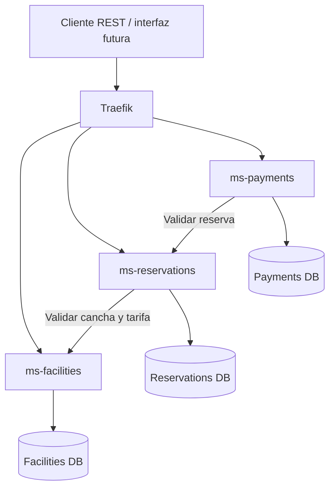

<div align="center">

# ⚽ A R E N A C O R E

### Sports Facility Management System

**Reserva · Administra · Conecta**


[Proyecto](#proyecto) · [Documentación](#documentacion) · [Arquitectura](#arquitectura) · [Instalación](#instalacion) · [Equipo](#equipo)

</div>

---

<a id="proyecto"></a>
## 🏟️ Sobre el proyecto

ArenaCore es una propuesta de sistema de gestión de complejos deportivos y canchas sintéticas que centraliza la consulta de disponibilidad, las reservaciones y el registro de pagos mediante una arquitectura de microservicios.

### Problemática

La administración manual mediante llamadas, mensajes y registros dispersos puede ocasionar reservas duplicadas, dificultades para consultar horarios y pérdida de trazabilidad de los pagos.

### Objetivo

Desarrollar una solución modular que facilite la administración de instalaciones deportivas y permita gestionar reservaciones de forma consistente.

### Alcance funcional previsto

| Módulo | Funcionalidades |
| --- | --- |
| Instalaciones | Complejos deportivos, canchas y tarifas |
| Reservaciones | Disponibilidad, creación, consulta y cancelación de reservas |
| Pagos | Registro y consulta de pagos asociados a reservas |

El MVP contempla reservas de una hora y registro manual de pagos. No incluye pasarela de pagos real, autenticación ni torneos. Las funcionalidades descritas corresponden al alcance previsto y no certifican su implementación.

<a id="documentacion"></a>
## 📚 Documentación y entregables

> Los enlaces externos quedan pendientes de incorporar. Sustituir cada comentario por un enlace Markdown al documento definitivo y comprobar los permisos de lectura.

| Entregable | Recurso |
| --- | --- |
| Descripción, contexto y alcance | Pendiente <!-- URL_DESCRIPCION --> |
| Product Backlog, épicas e historias de usuario (Gherkin) | Pendiente <!-- URL_BACKLOG --> |
| Historias técnicas y requerimientos no funcionales | Pendiente <!-- URL_REQUERIMIENTOS --> |
| ADRs | Pendiente <!-- URL_ADRS --> |
| Job Stories | Pendiente <!-- URL_JOB_STORIES --> |
| Jobs To Be Done (JTBD) | Pendiente <!-- URL_JTBD --> |
| Diagramas de secuencia PlantUML | Pendiente <!-- URL_SECUENCIA --> |
| Queries y Actions | Pendiente <!-- URL_QUERIES_ACTIONS --> |
| Event Storming | Pendiente <!-- URL_EVENT_STORMING --> |
| Bounded Contexts y servicios candidatos | Pendiente <!-- URL_BOUNDED_CONTEXTS --> |
| Modelado de datos | Pendiente <!-- URL_MODELO_DATOS --> |
| Patrones de interacción | Pendiente <!-- URL_INTERACCION --> |
| Informe de primera entrega | Pendiente <!-- URL_ENTREGA_1 --> |
| Informe de segunda entrega y evidencias | Pendiente <!-- URL_ENTREGA_2 --> |

### Gestión del proyecto

| Recurso | Acceso |
| --- | --- |
| Issues | [Ver historias y tareas](https://github.com/saesgru1025-design/ProyectoDs3-ArenaCore/issues) |
| GitHub Projects | [Ver proyectos del repositorio](https://github.com/saesgru1025-design/ProyectoDs3-ArenaCore/projects) |
| Pull requests | [Ver contribuciones](https://github.com/saesgru1025-design/ProyectoDs3-ArenaCore/pulls) |
| Tablero específico | Pendiente <!-- URL_TABLERO --> |
| Carpeta de documentos externos | Pendiente <!-- URL_DRIVE --> |

<a id="arquitectura"></a>
## 🧩 Arquitectura propuesta



| Microservicio | Responsabilidad |
| --- | --- |
| `ms-facilities` | Administración de instalaciones y tarifas |
| `ms-reservations` | Disponibilidad y ciclo de vida de reservas |
| `ms-payments` | Registro de pagos |

Cada servicio dispone de una base de datos independiente en el diseño propuesto. La comunicación se realiza mediante APIs REST y Docker Compose coordina los contenedores en el entorno local.

## 🛠️ Stack tecnológico previsto

| Tecnología | Uso |
| --- | --- |
| Node.js / Express | Servicios REST |
| PostgreSQL | Persistencia |
| Docker / Compose | Entorno local reproducible |
| Traefik | Enrutamiento |
| PlantUML / Mermaid | Diagramas |
| GitHub Projects | Seguimiento de tareas |

## 📂 Organización propuesta del repositorio

```text
ProyectoDs3-ArenaCore/
├── ADRs/
├── Diagramas/
├── docs/
├── EventStorming/
├── Issues/
├── JobStories/
├── ms-facilities/
├── ms-reservations/
├── ms-payments/
└── README.md
```

Ajustar esta estructura a los archivos reales del repositorio antes de publicar la versión definitiva.

<a id="instalacion"></a>
## 🚀 Instalación y ejecución

### Clonar el repositorio

```bash
git clone https://github.com/saesgru1025-design/ProyectoDs3-ArenaCore.git
cd ProyectoDs3-ArenaCore
```

### Entorno Docker (cuando esté disponible)

Requisitos previstos: Git, Docker y Docker Compose. Si la configuración `docker-compose.yml` y las variables de entorno ya están disponibles y documentadas, ejecutar desde la raíz:

```bash
docker compose up --build -d
docker compose ps
```

Para detener el entorno:

```bash
docker compose down
```

La configuración, puertos, endpoints y pruebas deben verificarse antes de declarar el entorno operativo.

## 🧪 Evidencias y demostración

| Evidencia | Enlace |
| --- | --- |
| Contenedores en ejecución | Pendiente <!-- URL_DOCKER --> |
| Consultas REST | Pendiente <!-- URL_CONSULTAS --> |
| Reservaciones y validaciones | Pendiente <!-- URL_RESERVAS --> |
| Registro de pagos | Pendiente <!-- URL_PAGOS --> |
| Video de demostración | Pendiente <!-- URL_VIDEO --> |

## 🗺️ Hoja de ruta

- [ ] Validar documentación y backlog de la primera entrega.
- [ ] Verificar implementación de los microservicios.
- [ ] Validar persistencia y comunicación REST.
- [ ] Ejecutar los contenedores y comprobar su estado.
- [ ] Consolidar evidencias y segunda entrega.

<a id="equipo"></a>
## 👥 Equipo de desarrollo

| Integrante | GitHub | Responsabilidad |
| --- | --- | --- |
| Pendiente de confirmar | Pendiente | Pendiente |
| Pendiente de confirmar | Pendiente | Pendiente |

## 🎓 Información académica

- **Institución:** Universidad del Valle, Seccional Yumbo (confirmar).
- **Programa:** Tecnología en Desarrollo de Software (confirmar).
- **Asignatura y docente:** pendientes de confirmar.
- **Proyecto:** ArenaCore.

---

<div align="center">

**ArenaCore** · Proyecto académico de arquitectura de microservicios

[Volver al inicio](#a-r-e-n-a-c-o-r-e)

</div>
